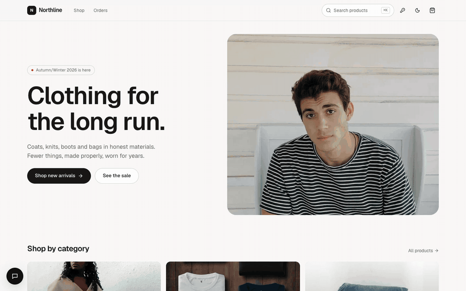
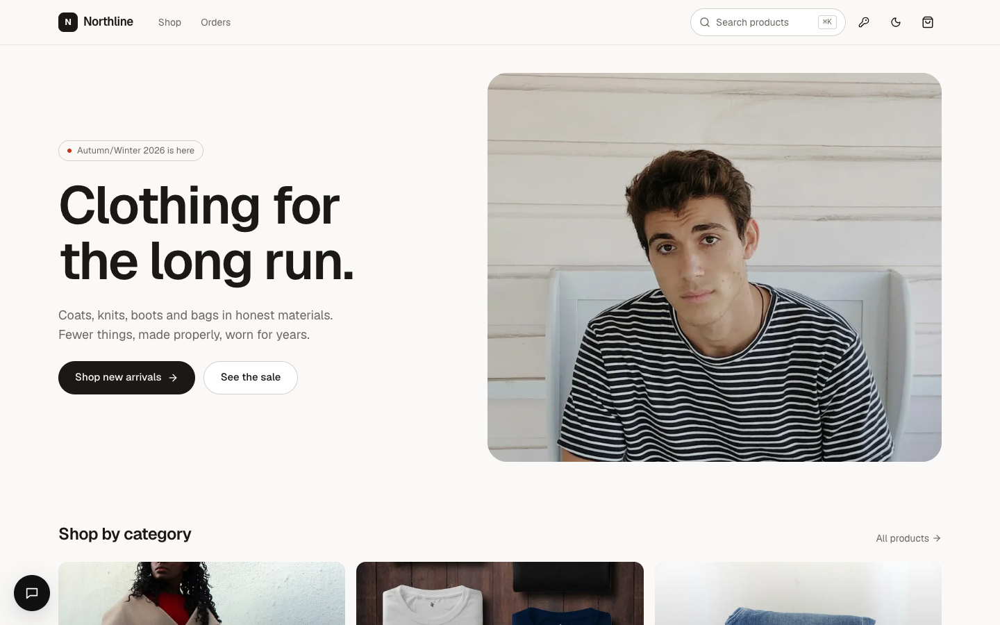
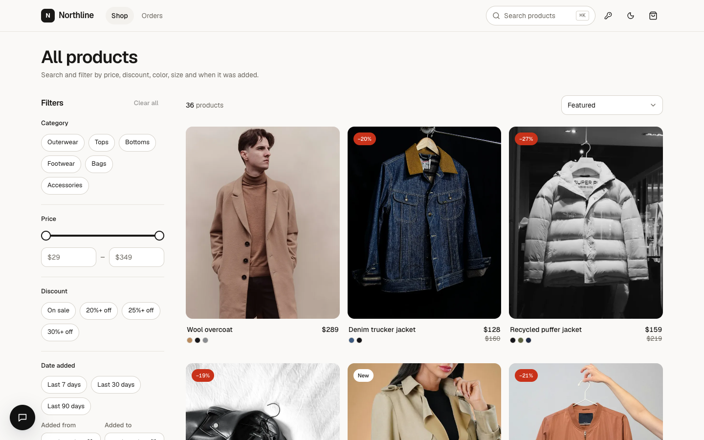
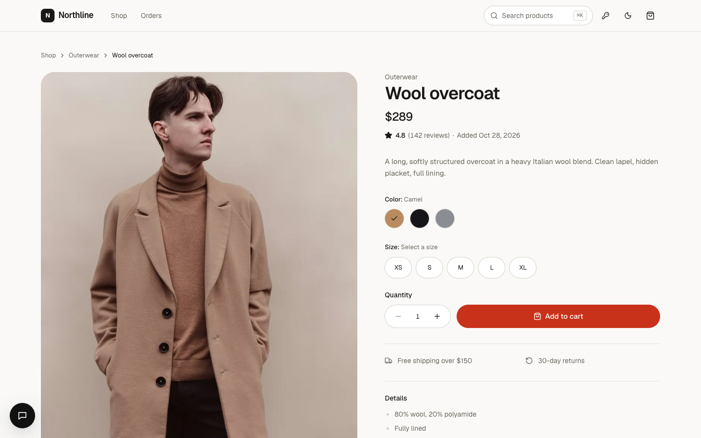
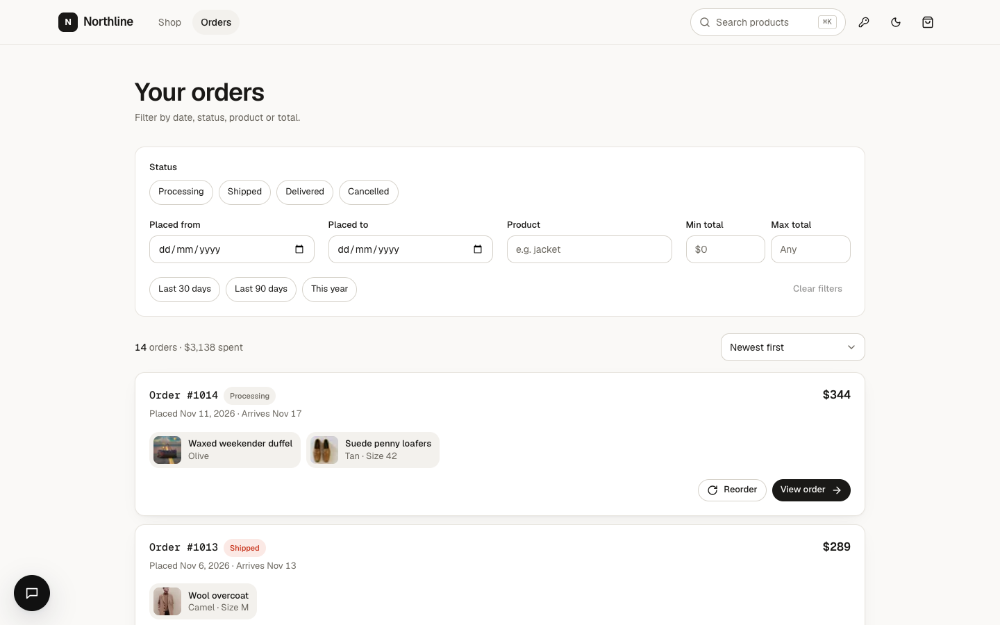
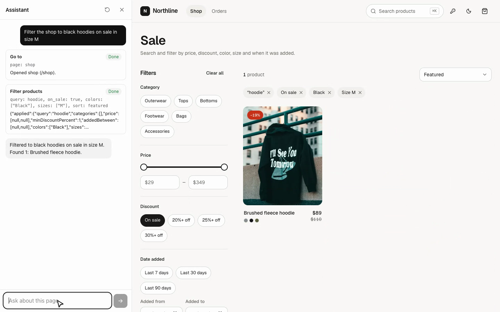
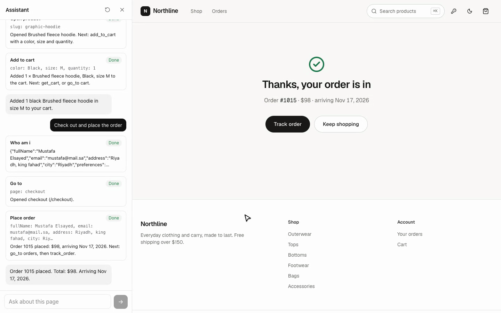

# Northline: a WebMCP storefront demo

A demo clothing store where an AI assistant shops **through the page itself**. Every page exposes
[WebMCP](https://github.com/webmachinelearning/webmcp) tools (search, filter, open a product, add to cart, check out,
track an order), and the assistant calls them in the visitor's browser, so each step happens on screen.

From a search to a placed order in three messages:

> 1. **"Filter the shop to black hoodies on sale in size M"**
> 2. **"Add the black one in size M to my cart"**
> 3. **"Check out and place the order"**



<sub>Played at 1.5× speed. [Full-quality clip (MP4)](docs/images/demo.mp4).</sub>

Here's what the assistant does at each step:

1. **Find:** `go_to` opens the shop, then `filter_products` with `query: hoodie, colors: [Black], sizes: [M], on_sale: true`.
   The filter chips, the URL and the grid all update.
2. **Add to cart:** `open_product` opens the hoodie's page, then `add_to_cart` with `color: Black, size: M, quantity: 1`.
   The pickers change and the cart badge counts up.
3. **Check out:** `who_am_i` reads the saved delivery details, `get_cart` checks the cart, and `go_to` opens checkout.
   Then `place_order` fills the form and **waits for you to click Place order**. The assistant can't place an order on
   its own: if nobody confirms within 10 seconds, the call fails and it asks you to confirm.

Other things to ask:

- _What did I order in March?_ (handed to the orders agent: `list_orders`, `open_order`, `track_order`)
- _Find something under $100 added this month_
- _Where is my latest order?_

## Screenshots

| Home | Shop |
| --- | --- |
|  |  |
| **Product** | **Orders** |
|  |  |
| **Assistant filtering the shop** | **Order placed** |
|  |  |

## How it works

- **Tools live with the UI they drive.** App-wide tools are in [`webmcp-agents/tools`](webmcp-agents/tools). Tools
  tied to one control (`add_to_cart`, `update_cart_item`, `place_order`, …) are registered by that component and exist
  only while it's mounted, so the agent can only do what the current page allows.
- **Agents pick from those tools.** [`shopper`](webmcp-agents/agents/shopper.ts) browses, filters and manages the cart.
  It hands questions about past orders to [`orders`](webmcp-agents/agents/orders.ts).
- **The model runs on the server, the tools run in the browser.** [`app/api/chat`](app/api/chat/route.ts) runs one model
  step per request with `@webmcp-agents/chat`. Tool calls go back to the page, run there, and their results go into the
  next step.
- **Bring your own key.** The key icon in the header opens AI settings, where a visitor can use their own OpenAI,
  DeepSeek, Z.ai or Moonshot key. The key is kept in an encrypted, httpOnly cookie that page scripts can't read. Without
  one, the server's own key and model are used.
- **Static data.** Products, orders and the signed-in user are fixtures in [`lib/data`](lib/data). There's no database.
  The cart and placed orders persist in `localStorage`.

Stack: Next.js 16 (App Router, Cache Components), React 19, Tailwind CSS 4, Radix UI, Zustand, React Hook Form + Zod,
the AI SDK and `@webmcp-agents/*`.

## Getting started

Requirements: [Bun](https://bun.sh) 1.3+ (or Node.js 20+ with npm) and an API key for one supported provider.

```bash
git clone https://github.com/webmcp-agents/storefront-demo.git
cd storefront-demo
bun install
cp .env.example .env.local
```

### Environment variables

Fill in `.env.local`. All variables are server-only: never give them a `NEXT_PUBLIC_` prefix.

| Variable | Required | Description |
| --- | --- | --- |
| `WEB_AGENTS_MODEL` | yes | The server's default model as `provider/model`, e.g. `openai/gpt-5.5` or `deepseek/deepseek-v4-pro`. |
| `OPENAI_API_KEY` | for `openai/…` | Key for the provider `WEB_AGENTS_MODEL` names. |
| `DEEPSEEK_API_KEY` | for `deepseek/…` | As above, for DeepSeek. |
| `AI_SETTINGS_SECRET` | yes | 32+ characters that encrypt visitors' keys in the AI settings cookie. Generate one with `openssl rand -base64 48`. Changing it clears every visitor's saved key. |

OpenAI and DeepSeek are installed. Other AI SDK providers (`@ai-sdk/anthropic`, `@ai-sdk/google`, …) resolve to
[a stub](lib/stubs/ai-provider.ts) that tells you which package to install.

### Develop, build and start

```bash
bun dev            # http://localhost:3000
bun run lint       # ESLint
bun run build      # production build
bun run start      # serve the production build on Node.js
```

## Project structure

```
app/                     Routes: home, shop, product/[slug], cart, checkout, orders, orders/[id]
  api/chat/              The assistant's model endpoint
  api/ai-settings/       Saves or clears a visitor's provider, model and key (encrypted cookie)
  providers.tsx          Client providers: WebMCP tools, tooltips, the shopper chat
components/
  ui/                    Primitives (shadcn/ui style, Radix based)
  layout/                Header, footer, nav, theme toggle, shopper chat
  home/ shop/ product/ cart/ checkout/ orders/ search/ ai-settings/
  shared/                Product card, grid, price, sort and toggle controls
hooks/                   One hook per page or feature (state, URL sync, forms)
lib/
  data/                  Static catalog, orders, user and assistant prompts
  stores/                Zustand stores (cart, filters, orders, UI, AI settings)
  schemas/               Zod schemas for checkout, purchase and AI settings
  ai/                    Provider list, model factory, encrypted settings cookie
  queries.ts             Filtering, sorting and formatting over the static data
webmcp-agents/
  agents/                shopper and orders agents (instructions + allowed tools)
  tools/                 App-wide WebMCP tools
public/images/           Product, category and hero photos (see CREDITS.md)
docs/images/             README screenshots and demo
wrangler.jsonc           Cloudflare Worker config
open-next.config.ts      OpenNext adapter config
```

## Deploy to Cloudflare

The app runs as a Cloudflare Worker through [OpenNext](https://opennext.js.org/cloudflare). The config is already in
the repo: [`wrangler.jsonc`](wrangler.jsonc), [`open-next.config.ts`](open-next.config.ts) and
[`public/_headers`](public/_headers).

1. **Sign in to Cloudflare** (once):

   ```bash
   bunx wrangler login
   ```

2. **Set the secrets** on the Worker (`WEB_AGENTS_MODEL` is a plain var in `wrangler.jsonc`; change it there):

   ```bash
   bunx wrangler secret put OPENAI_API_KEY
   bunx wrangler secret put AI_SETTINGS_SECRET
   ```

3. **Preview the Worker locally**, in the real Workers runtime (http://localhost:8787):

   ```bash
   bun run preview
   ```

4. **Deploy:**

   ```bash
   bun run deploy
   ```

   The Worker is served at `https://webmcp-storefront-demo.<your-subdomain>.workers.dev`. To change the name, edit
   `name` and `services[0].service` in `wrangler.jsonc`. Add a custom domain in the dashboard under
   **Workers & Pages → your Worker → Settings → Domains & Routes**.

`bun run upload` builds and uploads a new version without sending it live, for gradual deployments. After you add
bindings to `wrangler.jsonc`, `bun run cf-typegen` regenerates their types.

### Deploy on every push (Workers Builds)

In the Cloudflare dashboard, go to **Workers & Pages → Create → Import a repository**, pick this repo, and set:

- Build command: `CLOUDFLARE_BUILD=1 bunx opennextjs-cloudflare build`
- Deploy command: `bunx opennextjs-cloudflare deploy`

Then add `OPENAI_API_KEY` and `AI_SETTINGS_SECRET` under **Settings → Variables and Secrets**.

### Notes

- **Cache Components are off in the Worker build.** On the Workers runtime they currently make renders hang
  ([opennextjs-cloudflare#1450](https://github.com/opennextjs/opennextjs-cloudflare/issues/1450),
  [next.js#94880](https://github.com/vercel/next.js/issues/94880)). The Cloudflare scripts set `CLOUDFLARE_BUILD=1`, and
  [`next.config.ts`](next.config.ts) then turns off `cacheComponents` and `partialPrefetching`. Every page still
  prerenders as static HTML. `bun dev` and `bun run build` keep them on. Remove the flag once the adapter ships the fix.
- **Local `.env` files are bundled into the Worker.** OpenNext copies any `.env*` file in the project into the
  server bundle. It isn't served publicly, but production keys belong in Worker secrets. Deploy from Workers Builds, or
  from a checkout that has no `.env.local`.
- **Images** are optimized by the `IMAGES` binding (Cloudflare Images), which has a free monthly allowance of
  transformations.
- **No incremental cache is configured.** The catalog is static, so there's nothing to provision beyond the Worker. If
  you add ISR or `use cache`, see [OpenNext caching](https://opennext.js.org/cloudflare/caching) to back it with R2.

## Credits

Photos are from Unsplash; see [`public/images/CREDITS.md`](public/images/CREDITS.md).
